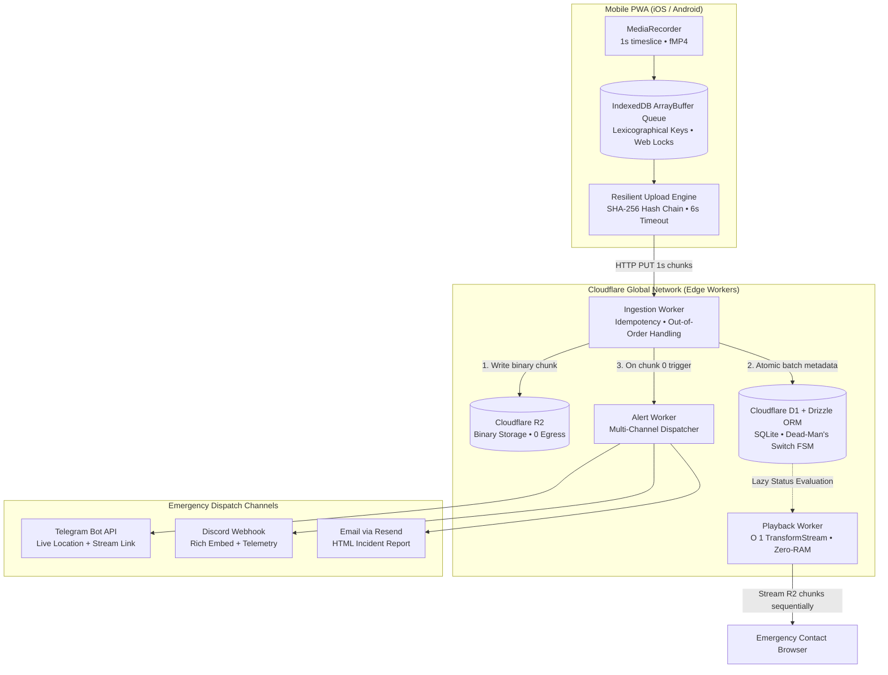

# Blackbox Protocol

> **A tamper-evident personal black box that streams video, audio, and telemetry to the cloud in real time. Designed to preserve evidence even if the recording device is seized or destroyed.**

[](https://github.com/jammerdeployed/blackbox-protocol/actions/workflows/ci.yml)
[](https://opensource.org/licenses/MIT)
[](https://www.typescriptlang.org/)
[](https://workers.cloudflare.com/)
[](https://orm.drizzle.team/)

---

## 🎯 The Problem

When individuals face hostile encounters, assault, or state overreach, traditional phone recording apps fail fundamentally:
1. **The Header Problem:** Standard MP4 encoders (`MediaRecorder`) write critical container atoms (`moov`) only after recording stops. If an attacker smashes the phone after 10 seconds, the entire file is corrupted and unrecoverable.
2. **Physical Seizure:** Destroying or seizing the phone deletes local footage before it can be shared.
3. **Network Hostility:** Subway tunnels, elevators, and cell jammers induce high packet loss, causing standard streaming protocols (WebSockets, WebRTC) to freeze or drop connections.

**Blackbox Protocol** solves this by implementing **sub-second fragmented offloading**: video is partitioned into 1-second chunks, cryptographically hashed, and uploaded to zero-cost edge storage over stateless HTTP/2 PUT requests. If a phone is destroyed 5 seconds into an assault, **4–5 seconds of video, audio, and GPS coordinates are already safe in the cloud and dispatched to emergency contacts.**

---

## 🏗️ System Architecture



---

## 🔬 Distributed Systems Engineering Highlights

### 1. Zero-RAM Edge Streaming ($O(1)$ Memory Complexity)
Cloudflare Workers run in V8 isolates capped at **128 MB RAM**. Storing video chunks in an in-memory buffer before serving causes Out-Of-Memory (OOM) crashes on recordings over ~40 MB. 
- The Playback Worker utilizes web **`TransformStream`** to pump R2 objects sequentially into the HTTP response stream.
- Memory consumption stays constant at **$\le 300\text{ KB}$** regardless of video length, with near-instantaneous Time-To-First-Byte (TTFB).
- Read the design decision: [ADR 0002: Zero-RAM Edge Streaming](docs/adr/0002-zero-ram-transformstream-playback.md).

### 2. Cross-Platform fMP4 Unification
Historically, Chrome and Safari produced incompatible formats (WebM vs MP4). Starting with Chromium 126+, browsers support fragmented MP4 (`video/mp4;codecs="avc1.42E01E,mp4a.40.2"`). 
- Blackbox Protocol enforces fMP4 container output across mobile browsers.
- Chunks consist of standardized `moof` + `mdat` atoms, allowing zero-remux playback directly in Safari and Chrome with zero server-side transcoding costs.
- Read the design decision: [ADR 0001: Fragmented MP4 Unification](docs/adr/0001-fragmented-mp4-unification.md).

### 3. Distributed Dual-Write & Out-of-Order Ingestion
- **R2-First:** Binary data is committed to R2 before updating D1 relational tables. R2 writes are naturally idempotent.
- **Batch Transactions:** D1 updates execute within atomic batch transactions.
- **Out-of-Order Acceptance:** If Chunk 2 is delayed on 4G but Chunk 3 arrives, the server provisions the session in an `ACTIVE` state and accepts Chunk 3 without head-of-line blocking.
- Read the design decision: [ADR 0003: Distributed Dual-Write Resilience](docs/adr/0003-dual-write-and-out-of-order-resilience.md).

### 4. Resilient iOS WebKit Offline Queue
- **ArrayBuffer Serialization:** Bypasses Apple WebKit's notorious memory detachment bug where disk-backed `Blob` references throw `NotReadableError` after screen lock.
- **Lexicographical Sequence Keys:** Keys are formatted as `${sessionId}_${sequence.padStart(8, '0')}`, ensuring IndexedDB cursors naturally read Chunk 0 (initialization atoms) first.
- **Web Locks API:** Coordinates queue flushing between browser threads and network transition events without race conditions.

### 5. Dead-Man's Switch (Lazy Evaluation FSM)
If an attacker destroys the device mid-recording, the client will never send a `POST /finalize` call.
- The system models session lifecycles as a Finite State Machine (`ACTIVE`, `INTERRUPTED`, `COMPLETED`, `CORRUPTED`).
- Every chunk upload serves as an implicit heartbeat.
- On query, the API employs **Lazy State Evaluation**: if `status === 'ACTIVE'` but `Date.now() - last_heartbeat_at > 15_000`, the session is dynamically evaluated as `INTERRUPTED`.

---

## 📦 Project Structure

```
blackbox-protocol/
├── apps/
│   └── web/                     # React 18 + Vite + Tailwind CSS PWA
│       ├── src/lib/recorder.ts  # fMP4 MediaRecorder service
│       ├── src/lib/uploader.ts  # Resilient IndexedDB Upload Engine
│       └── src/lib/locales/     # Localization dictionary (cs.ts)
├── packages/
│   ├── db/                      # Drizzle ORM schema for Cloudflare D1
│   │   ├── src/schema.ts        # Sessions & chunks tables with indexes
│   │   └── run-sql-migrate.cjs  # Direct DDL migration runner
│   └── shared/                  # Domain types, protocols, and constants
├── workers/
│   ├── ingestion/               # Chunk upload & idempotency worker
│   ├── alert/                   # Telegram, Discord, Resend dispatcher
│   └── playback/                # O(1) TransformStream video playback
├── docs/adr/                    # Architecture Decision Records
└── .github/workflows/ci.yml     # Automated lint, typecheck & test pipeline
```

---

## 🚀 Getting Started

### Prerequisites
- [Node.js](https://nodejs.org/) >= 18.0.0
- [pnpm](https://pnpm.io/) >= 9.0.0
- [Cloudflare Wrangler CLI](https://developers.cloudflare.com/workers/wrangler/) (`pnpm add -g wrangler`)

### Installation & Build

```bash
# Clone repository
git clone https://github.com/jammerdeployed/blackbox-protocol.git
cd blackbox-protocol

# Install dependencies across all workspace packages
pnpm install

# Run TypeScript typecheck across monorepo
pnpm typecheck

# Run test suite
pnpm test

# Build web application
pnpm --filter @blackbox-protocol/web build
```

### Cloudflare Infrastructure Setup

1. **Create R2 Storage & D1 Database:**
```bash
# Create binary video storage bucket
npx wrangler r2 bucket create witness-chunks

# Create relational metadata database
npx wrangler d1 create witness-meta
# (Copy the generated database_id into workers/ingestion/wrangler.toml & workers/playback/wrangler.toml)
```

2. **Apply Database Migration:**
```bash
# Apply schema to local D1 instance
pnpm --filter @blackbox-protocol/db run migrate:local

# Apply schema to remote Cloudflare D1 database
pnpm --filter @blackbox-protocol/db run migrate:remote
```

3. **Configure Worker Secrets:**
```bash
# Ingestion Worker auth token (used by mobile client)
npx wrangler secret put AUTH_TOKEN --cwd workers/ingestion

# Alert Worker secrets (Discord webhook, Telegram, service secret)
npx wrangler secret put ALERT_SECRET --cwd workers/alert
npx wrangler secret put DISCORD_WEBHOOK_URL --cwd workers/alert
npx wrangler secret put PLAYBACK_BASE_URL --cwd workers/alert
```

4. **Deploy Edge Workers:**
```bash
npx wrangler deploy --cwd workers/ingestion
npx wrangler deploy --cwd workers/playback
npx wrangler deploy --cwd workers/alert
```

---

### 🔔 Emergency Dispatch Channels Setup

#### Option A: Discord Webhook (Fastest & Recommended)
1. Open your Discord server and navigate to your private/emergency channel (e.g. `#safety-alerts`).
2. Go to **Channel Settings** (gear icon) ➔ **Integrations** ➔ **Webhooks** ➔ **New Webhook**.
3. Name it `Blackbox Witness` and click **Copy Webhook URL**.
4. Store the webhook in the Alert Worker:
   ```bash
   npx wrangler secret put DISCORD_WEBHOOK_URL --cwd workers/alert
   ```

#### Option B: Telegram Bot
1. In Telegram, search for [@BotFather](https://t.me/BotFather) and send `/newbot`.
2. Follow prompts to name your bot; copy the generated HTTP API token.
3. Save the token into the Alert Worker:
   ```bash
   npx wrangler secret put TELEGRAM_BOT_TOKEN --cwd workers/alert
   ```
4. Start a chat with your new bot (press **Start**).
5. Obtain your numeric Chat ID by forwarding a message to [@userinfobot](https://t.me/userinfobot) (or query `https://api.telegram.org/bot<YOUR_TOKEN>/getUpdates`).
6. Store your chat ID:
   ```bash
   npx wrangler secret put TELEGRAM_CHAT_ID --cwd workers/alert
   ```

#### Connecting Ingestion ➔ Alert Worker (Service Binding)
In Cloudflare Dashboard, open `witness-ingestion` ➔ **Settings** ➔ **Variables and Secrets** ➔ **Service Bindings**:
- **Variable name:** `ALERT_SERVICE`
- **Service:** `witness-alert`
- **Environment:** `production`
*(Ensure `ALERT_SECRET` is set to the same shared string in both workers to authenticate inter-worker dispatch).*

---

## 🧪 Testing

The test suite covers offline queue state machines, cryptographic hash calculation, protocol constants, and edge worker lazy evaluation:

```bash
pnpm test
```

---

## 🛡️ Privacy, Security & Community

- 🔐 **Privacy Architecture:** [PRIVACY.md](PRIVACY.md) — Zero-knowledge, single-tenant data sovereignty model.
- 🚨 **Security & Vulnerabilities:** [SECURITY.md](SECURITY.md) — Tamper-evident verification and coordinated disclosure.
- 🤝 **Code of Conduct:** [CODE_OF_CONDUCT.md](CODE_OF_CONDUCT.md) — Contributor Covenant v2.1.
- 📄 **License:** [MIT License](LICENSE) — Copyright (c) 2026 Tomáš Chytil.
